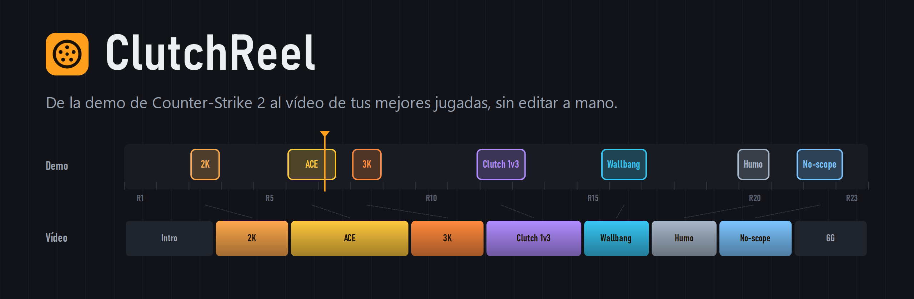
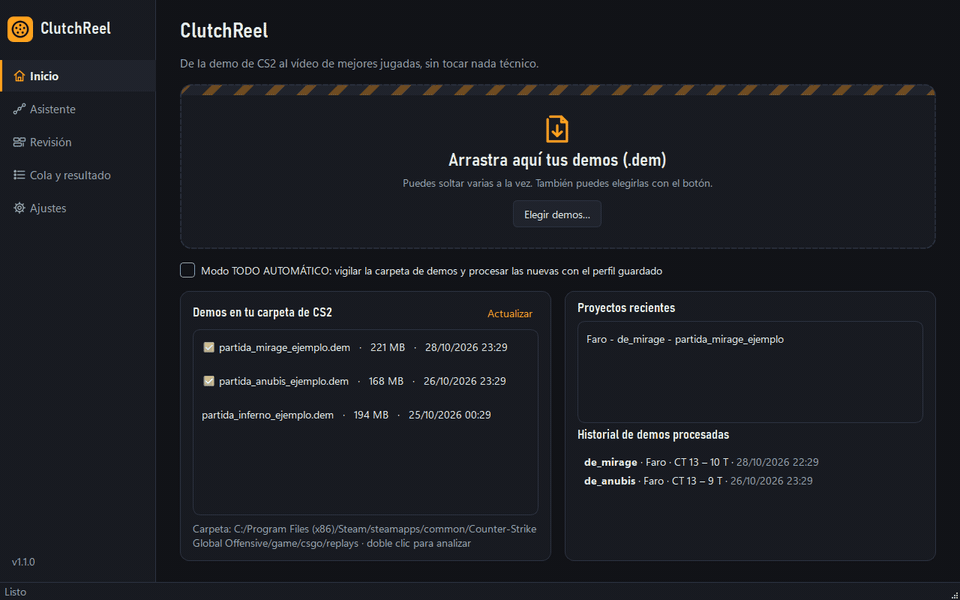
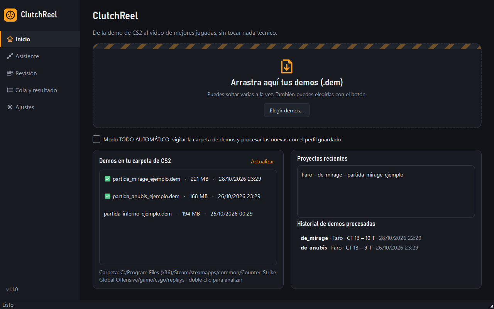
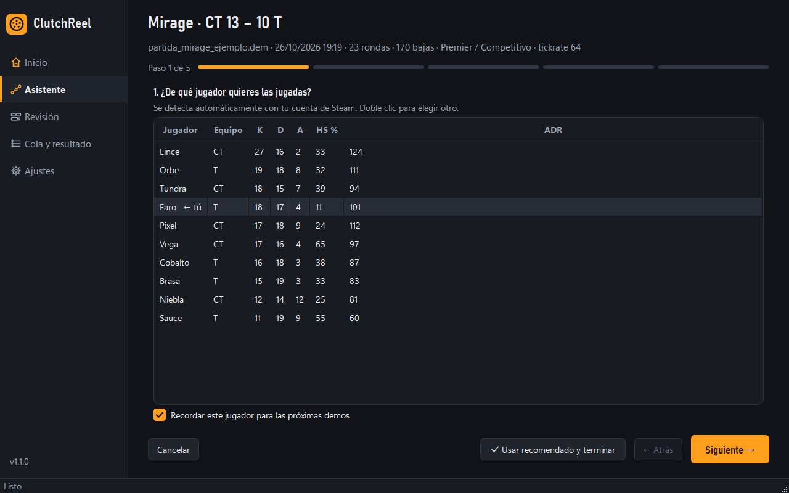
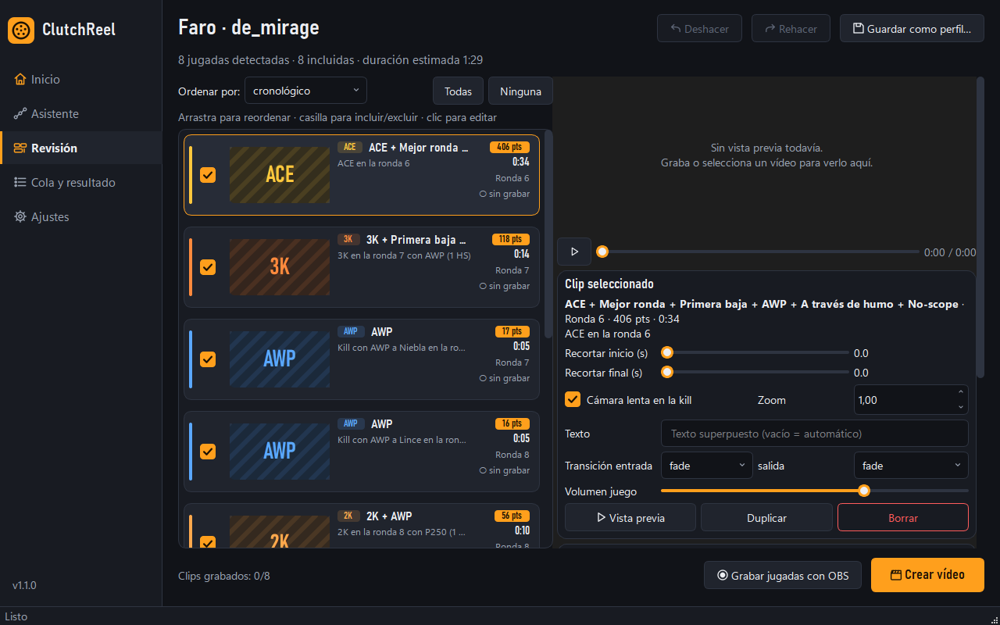
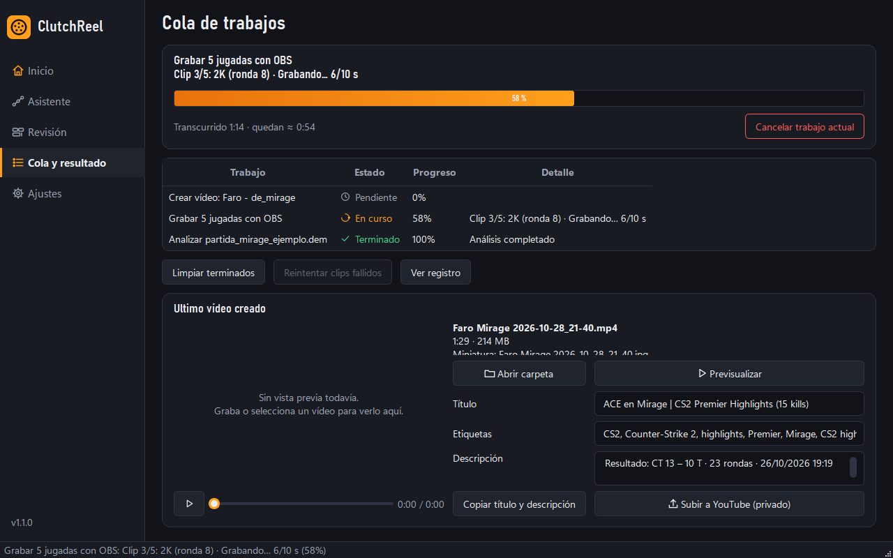
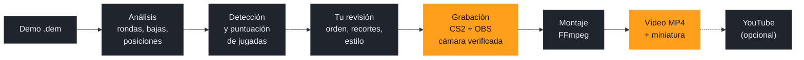

<p align="center">
  
</p>

<p align="center">
  
  
  
  
  
</p>

<p align="center">
  <a href="#instalación">Instalación</a> ·
  <a href="#tu-primer-vídeo-paso-a-paso">Guía paso a paso</a> ·
  <a href="#cómo-funciona">Cómo funciona</a> ·
  <a href="#preguntas-frecuentes">Preguntas frecuentes</a> ·
  <a href="#solución-de-problemas">Problemas</a>
</p>

**ClutchReel** convierte la demo de una partida de **Counter-Strike 2** en un vídeo con tus mejores jugadas, listo para YouTube o para Shorts. Arrastras la demo, contestas cinco preguntas (o pulsas «Usar recomendado») y el programa hace el resto: encuentra tus ACE, clutches y multikills, los graba desde el visor oficial de demos con OBS y monta el vídeo con intro, cámara lenta, marcador de kills, música y miniatura.

> **In English:** ClutchReel turns a Counter-Strike 2 match demo into a highlights video. It parses the `.dem` file, finds and scores your best plays (aces, clutches, multi-kills, wallbangs…), records each one from the official in-game demo viewer through OBS, checking that the camera is really on your player, and edits the final video with FFmpeg (intro, slow motion, kill counter, music, thumbnail, YouTube metadata). Windows only; the interface is in Spanish.

<p align="center">
  
</p>

---

## Qué es y para qué sirve

Después de una buena partida de Premier o Competitivo, CS2 te deja descargar la demo: la grabación completa de la partida, desde cualquier punto de vista. Sacar de ahí un vídeo de highlights a mano es lento: ver 40 minutos de demo, apuntar las rondas buenas, grabar cada jugada con la cámara en tu jugador, cortarlas, unirlas y exportar. Fácilmente una o dos horas por partida.

ClutchReel automatiza ese trabajo de principio a fin:

- **Encuentra las jugadas por ti.** Lee la demo entera en un par de segundos y detecta 17 tipos de jugada (ACE, clutch 1vX, 2K–4K, rachas de headshots, wallbangs, kills a través de humo…). A cada una le da una puntuación y elige las mejores para la duración que quieras.
- **Las graba sin que toques nada.** Abre OBS y CS2, salta a cada jugada en el visor de demos, pone la cámara en tu jugador **y comprueba que de verdad está en él** antes y durante la grabación. Un clip con la cámara en otra persona nunca se da por bueno.
- **Monta un vídeo terminado:** intro con tu nombre y el mapa, transiciones, marcador de kills, cámara lenta en el momento clave, música con el volumen ajustado al del juego, cierre, audio normalizado a −14 LUFS y miniatura. En 16:9 (1080p, 1440p o 4K a 60 fps) o en vertical 9:16 para Shorts y TikTok.
- **Te deja retocarlo.** Antes de grabar revisas las jugadas, las reordenas, recortas, quitas las que sobran y cambias el estilo. Con deshacer y rehacer.
- **Prepara la publicación:** título, descripción y etiquetas sugeridos, y subida opcional a YouTube (como vídeo privado).

**Para quién es:** para jugadores que quieren guardar o compartir sus mejores partidas, creadores de contenido que publican highlights a menudo y equipos que repasan sus rondas clave. No hace falta saber editar vídeo.

En nuestras pruebas (Windows 11, RTX 4060 Ti) un vídeo de 5 jugadas tarda unos **3 minutos** desde que sueltas la demo: 1 s de análisis, unos 2 min de grabación y unos 30 s de montaje.

> **Proyecto independiente.** ClutchReel no está afiliado, patrocinado ni aprobado por Valve Corporation ni por el proyecto OBS Studio. Más detalles en [Avisos](#licencia-y-avisos).

---

## Capturas

<table>
  <tr>
    <td width="50%"></td>
    <td width="50%"></td>
  </tr>
  <tr>
    <td><b>Inicio.</b> Arrastra una o varias demos, o elige una de la carpeta de CS2.</td>
    <td><b>Asistente.</b> Cinco preguntas: jugador, tipos de jugada, duración, estilo y forma de grabar.</td>
  </tr>
  <tr>
    <td></td>
    <td></td>
  </tr>
  <tr>
    <td><b>Revisión.</b> Cada tipo de jugada tiene su color. Reordena, recorta y ajusta antes de grabar.</td>
    <td><b>Cola y resultado.</b> Progreso, tiempo restante, y el vídeo listo con título y descripción para YouTube.</td>
  </tr>
</table>

<sub>Capturas con nombres de jugador ficticios.</sub>

---

## Cómo funciona



1. **Análisis.** Lee la demo con [demoparser2](https://github.com/LaihoE/demoparser) (en modo solo lectura): mapa, marcador, rondas, alineaciones de cada ronda (también tras el cambio de lado y en la prórroga), cada baja con sus detalles (headshot, wallbang, a través de humo, cegado, en el aire, no-scope…) y el daño para el ADR. El resultado se guarda en caché: volver a analizar la misma demo es instantáneo.
2. **Detección y puntuación.** Busca los 17 tipos de jugada de la tabla de abajo, une las que se solapan en la misma ronda y les pone nota según unos pesos que puedes cambiar (un ACE vale más que un 2K; un headshot o un no-scope suman). Después elige las mejores hasta llenar la duración que pediste (1–3, 3–5 o 5–10 minutos, o sin límite).
3. **Tu revisión.** Ves las jugadas como tarjetas y decides qué entra, en qué orden y con qué estilo.
4. **Grabación con cámara verificada.** ClutchReel abre CS2 por Steam con `-insecure` (el juego no se conecta a servidores con VAC mientras está así) y controla el visor de demos con **comandos de consola normales** a través del puerto de consola local. Para cada jugada salta al tick exacto, pone la cámara en tu jugador y la comprueba de dos formas: compara la posición de la cámara con la de tu jugador en la demo y lee el aviso de CS2 sobre a quién sigue. Graba con OBS y vuelve a comprobarlo durante la grabación. Si la cámara pasa a otro jugador, el clip se marca como fallido y se puede repetir.
5. **Montaje.** FFmpeg recorta cada clip, aplica la cámara lenta, los textos y el marcador, une todo con transiciones, mezcla la música bajándola cuando suena el juego (*ducking*), normaliza el audio y crea la miniatura. Usa la tarjeta gráfica si puede (NVIDIA NVENC, AMD AMF, Intel QSV) y, si no, el procesador.

### Qué jugadas detecta

| Tipo | Qué es |
|---|---|
|  | Las 5 bajas de la ronda son tuyas. |
|    | Varias bajas seguidas (por defecto, sin más de 12 s entre una y otra). |
|  | Te quedas solo contra 2 o más rivales (1vX). Cuenta más si ganas la ronda; las perdidas son opcionales. |
|  | 3 o más headshots seguidos en la misma ronda. |
|  | Haces la primera baja de la ronda (*entry*). |
|   | Bajas con AWP, y sin apuntar con la mira. |
|   | Bajas atravesando una pared o a través de una granada de humo. |
|    | Bajas estando cegado por una flash, saltando o a cuchillo. |
|  | Tus bajas en una ronda ganada que decide: la última, una bola de partido o un empate apretado. |
|  | Tu ronda con más puntuación de toda la partida. |
|  | Cada una de tus bajas como clip aparte (para vídeos largos). |

Los colores son los mismos que verás en las tarjetas de la aplicación.

### Qué lleva el vídeo final

| Parte | Detalle |
|---|---|
| Intro (3 s) | Tu nombre y el mapa, el marcador final y, si quieres, el nombre de tu canal. |
| Cada jugada | Título de la jugada y la ronda, marcador «KILLS 1, 2, 3…», cámara lenta (×0,5 durante 1,2 s) en la última baja y zoom opcional. |
| Entre jugadas | Fundido, o una transición: fundido a negro, barrido, deslizamiento, círculo o disolución. |
| Cierre (3 s) | «GG» y tu canal. |
| Audio | Sonido del juego, música opcional que baja cuando suena el juego, fundidos y volumen normalizado a −14 LUFS (el que usa YouTube). |
| Formatos | YouTube 1080p60, 1440p60 o 4K60 (16:9), o Shorts/TikTok 1080×1920 (9:16) con el encuadre centrado en la acción. |
| Extras | Miniatura JPG del mejor momento, y título, descripción y etiquetas sugeridos para YouTube. |

---

## Requisitos

| Qué | Para qué | Dónde |
|---|---|---|
| Windows 10/11 64 bits | — | — |
| Python 3.12 o superior (probado con 3.12) | ejecutar la app | `Iniciar.bat` lo comprueba y te explica cómo instalarlo (`winget install Python.Python.3.12`) |
| FFmpeg | cortar, unir y exportar | `Iniciar.bat` lo descarga solo en `tools\ffmpeg` si no está instalado (ver nota abajo) |
| Steam + Counter-Strike 2 | reproducir las demos para grabarlas | se detectan por el registro de Windows y `libraryfolders.vdf` |
| OBS Studio 28 o superior | grabar la pantalla del juego (incluye obs-websocket) | https://obsproject.com |
| GPU NVIDIA / AMD / Intel | codificación por hardware (opcional; si no, CPU) | se detecta automáticamente |

Sin OBS ni CS2 puedes usar igualmente el modo **«Ya tengo la grabación»**: le das el vídeo de la partida completa y ClutchReel corta las jugadas de ahí.

**Sobre FFmpeg.** FFmpeg es un programa aparte, no forma parte de ClutchReel. Si no lo tienes, `Iniciar.bat` descarga la compilación «essentials» de [gyan.dev](https://www.gyan.dev/ffmpeg/builds/) (licencia GPL-3.0) en la carpeta `tools\ffmpeg` de tu copia. Si prefieres instalarlo tú, usa `winget install Gyan.FFmpeg` o indica la ruta de tu `ffmpeg.exe` en Ajustes → Rutas.

---

## Instalación

Hay dos formas. La primera es la recomendada porque permite actualizar con un doble clic.

**A. Con Git (recomendada)**

1. Instala [Git](https://git-scm.com/download/win) si no lo tienes (`winget install Git.Git`).
2. Abre una terminal en la carpeta donde quieras ClutchReel y ejecuta:
   ```
   git clone https://github.com/svetoslav1999/clutchreel.git
   ```
   Vale cualquier carpeta, también con espacios, tildes u OneDrive.

**B. Sin Git**

1. En la página del repositorio pulsa **Code → Download ZIP**.
2. Descomprime el ZIP donde quieras.

Con esta forma `Actualizar.bat` no funciona: para actualizar, descarga el ZIP nuevo y sustituye la carpeta (tu configuración está en `%APPDATA%\ClutchReel` y no se pierde).

**Primer arranque (en los dos casos)**

1. Haz **doble clic en `Iniciar.bat`**. La primera vez:
   - comprueba que tienes Python 3.12 o superior (si falta, te ofrece instalarlo con winget);
   - crea el entorno virtual `.venv` e instala las dependencias (versiones fijadas en `requirements.txt`);
   - comprueba FFmpeg y, si falta, lo descarga (ver «Sobre FFmpeg», ~90 MB);
   - abre ClutchReel. Tarda unos minutos solo la primera vez; las siguientes arranca directamente.
2. Se abre la **primera configuración**: muestra lo detectado (Steam, CS2, OBS, FFmpeg, demos) y toma tu cuenta de Steam como jugador. Tu configuración se guarda solo en tu PC, en `%APPDATA%\ClutchReel\config.json`; el repositorio no contiene contraseñas, SteamIDs ni rutas.
3. En **Ajustes → OBS** pulsa **«Configurar OBS automáticamente»**: activa el servidor WebSocket de OBS con una contraseña nueva, la guarda en ClutchReel y reabre OBS (avisa antes de cerrarlo).
4. Con un proyecto abierto, **Ajustes → Probar grabación (calibrar)** para medir la latencia de tu PC (ver [Calibración](#la-primera-grabación-calibración)).

También puedes abrir una demo directamente: `Iniciar.bat "C:\ruta\partida.dem"`.

### Ejecutable opcional (.exe)

`scripts\construir_exe.bat` genera `dist\ClutchReel\ClutchReel.exe` con PyInstaller (necesita haber ejecutado antes `Iniciar.bat`).

---

## Tu primer vídeo, paso a paso

**1. Consigue la demo.** En CS2 ve a **Ver partidas → Tus partidas**, elige la partida y pulsa **Descargar**. La demo se guarda en la carpeta del juego y ClutchReel la muestra sola en la lista «Demos en tu carpeta de CS2».

**2. Ábrela en ClutchReel.** Arrástrala a la zona grande de **Inicio**, haz doble clic en la lista o pulsa «Elegir demos…». Puedes soltar varias a la vez. El análisis tarda un par de segundos.

**3. Contesta el asistente** (o pulsa **«Usar recomendado y terminar»** para saltártelo):

1. **Jugador:** se marca tu cuenta de Steam («← tú») y se recuerda para la próxima vez. Si tu cuenta no está en la demo, no se elige a nadie por ti: selecciona tu jugador en la lista.
2. **Qué sacar:** los tipos de jugada de la tabla de arriba. «Recomendado» marca los más vistosos.
3. **Duración:** 1–3, 3–5, 5–10 minutos o sin límite. Se eligen las mejores por puntuación hasta llenarla.
4. **Estilo:** formato (YouTube o Shorts), música, transiciones, intro y cierre, marcador de kills, cámara lenta y el nombre de tu canal.
5. **Grabación:** automática con OBS (lo normal) o «Ya tengo la grabación» si ya tienes el vídeo de la partida entera.

**4. Revisa las jugadas.** En **Revisión** cada jugada es una tarjeta con su tipo, ronda, puntuación y duración:

- arrastra para cambiar el orden, o usa «Ordenar por: cronológico / mejor puntuación / crescendo»;
- desmarca las que no quieras;
- en el panel derecho recorta el inicio o el final, activa la cámara lenta, añade un texto propio, haz zoom, elige las transiciones y el volumen del juego;
- abajo, «Vídeo completo» cambia la música, la intro, el cierre, el logo y el formato;
- Ctrl+Z / Ctrl+Y deshacen y rehacen; todo se guarda solo en un proyecto `.clutchreel.json`;
- «Guardar como perfil…» guarda tu estilo para reutilizarlo.

**5. Pulsa «Crear vídeo».** Si faltan grabaciones, ClutchReel abre OBS y CS2, reproduce la demo y graba cada jugada; después monta y exporta. Mientras graba, deja el PC tranquilo: el juego está en pantalla. En **Cola y resultado** ves el progreso y el tiempo que queda, y puedes cancelar en cualquier momento (se para OBS, se borra el clip a medias y CS2 recupera sus ajustes). Si algún clip falla, aparece en rojo con el motivo y al volver a pulsar «Crear vídeo» solo se repiten los fallidos.

**6. Publica.** Al terminar se abre la carpeta del vídeo (`Vídeos\ClutchReel`). En **Cola y resultado** puedes verlo, copiar el título, la descripción y las etiquetas sugeridos, o pulsar «Subir a YouTube (privado)» si lo has configurado.

### Otros modos

- **Modo TODO AUTOMÁTICO.** Activa la casilla en Inicio (o en el icono de la bandeja). ClutchReel vigila la carpeta de demos de CS2 y, cuando aparece una nueva, la analiza, la graba y la exporta con tu perfil guardado, y te avisa con una notificación de Windows.
- **Shorts / TikTok.** Elige el formato «Shorts / TikTok 1080×1920» en el asistente: el vídeo sale en vertical, con los textos ajustados al ancho.
- **«Ya tengo la grabación».** Si grabaste la partida entera con OBS mientras jugabas, elige ese vídeo e indica el desfase (el segundo del vídeo en el que empieza la demo). ClutchReel corta las jugadas de ahí sin abrir CS2; si alguna jugada cae fuera del vídeo, te avisa de cuál.

---

## La primera grabación: calibración

La grabación automática depende de tu PC, de OBS y de la versión de CS2, así que **la primera vez pulsa `Ajustes → Probar grabación (calibrar)`** con un proyecto abierto. ClutchReel:

1. conecta con OBS (o lo abre con el WebSocket activado), crea la escena «ClutchReel» con una fuente *Game Capture* de `cs2.exe` (si sale negra prueba *Window Capture* y luego *Display Capture*);
2. lanza CS2 por Steam con `-insecure -novid -console -netconport 2121`;
3. carga la demo, salta a la mejor jugada, sigue a tu jugador, **comprueba por la consola que la cámara está en él** y graba 6 s;
4. mide la latencia entre `demo_resume` y el primer fotograma con movimiento, y la guarda en `Ajustes → CS2 → Latencia medida`.

Revisa el clip en la vista previa. Cada clip grabado lleva en su tarjeta de Revisión el jugador al que siguió la cámara de verdad; si la cámara no se pudo poner en tu jugador, el clip se marca como fallido con el motivo (nunca se da por bueno sin comprobar).

<details>
<summary><b>Cómo envía ClutchReel los comandos a CS2</b></summary>

1. **Puerto de consola** (`-netconport`): socket TCP local. Con CS2 1.41.9 (octubre de 2026) el puerto abre en Windows sin `-tools` (y con `-tools` el juego se cerraba al saltar en la demo), así que la casilla «Añadir -tools» está desactivada. Es el único canal que permite **leer** la consola, y por tanto comprobar a quién sigue la cámara: ClutchReel compara la posición de la cámara (`getpos`) con la posición del jugador en la demo en ese tick y, además, lee el anuncio de CS2 «Added TrueView prediction for player slot N (nombre)». Un clip solo se da por bueno si ambas pruebas coinciden con tu jugador, antes y durante la grabación.
2. **Teclado**: si el puerto no responde, ClutchReel pone CS2 en primer plano, abre la consola, teclea `exec clutchreel` (los comandos van en `cfg\clutchreel.cfg`) y la cierra.
3. **Semiautomático**: si tampoco funciona, aparece una ventana con los comandos para que los teclees tú y pulses «Hecho».

</details>

---

## Juego limpio y privacidad

ClutchReel **solo lee** los ficheros `.dem`, usa el **visor oficial de demos del juego** y **comandos de consola normales** (`playdemo`, `demo_gototick`, `demo_step_tick`, `demo_pause`, `spec_player`, `spec_mode`, `getpos`…).

**Qué hace con el juego**

- Lee los ficheros `.dem` del disco (solo lectura) con la librería demoparser2.
- Abre CS2 a través de Steam con `-insecure` (sin VAC: el juego no puede entrar en partidas oficiales mientras está así) y `-netconport`, y reproduce la demo en el visor oficial.
- Le envía comandos de consola normales del visor por el puerto de consola local o, como respaldo, tecleándolos.
- Cambia temporalmente algunas variables de interfaz para grabar limpio (FPS en pantalla, aviso de TrueView, barra del reproductor, sonido sin foco…) y las **restaura** al terminar.
- Graba la pantalla con OBS a través de obs-websocket.

**Qué NO hace**

- No inyecta código, no lee ni escribe la memoria del juego, no usa DLL, hooks ni overlays propios.
- No modifica ni parchea ficheros del juego. Lo único que puede escribir en la carpeta de CS2 es `cfg/clutchreel.cfg` (con esos mismos comandos de consola) si activas el modo de respaldo por teclado, y una copia de la demo en `replays` si activas esa opción.
- No se conecta a servidores de partidas ni funciona en partidas online: solo con demos ya descargadas.

**Tus datos**

- No hay telemetría, estadísticas de uso ni cuentas. Todo se queda en tu PC (`%APPDATA%\ClutchReel` y la carpeta de vídeos).
- Para proponerte tu jugador lee, solo en local, las cuentas de Steam iniciadas en el PC (`loginusers.vdf`).
- Conexiones de red: OBS y la consola de CS2 en tu propio PC (`127.0.0.1`); la descarga de FFmpeg desde gyan.dev y de dependencias desde PyPI al instalar; GitHub al usar `Actualizar.bat`; y la API de YouTube solo si activas la subida, con tus credenciales.
- La contraseña de OBS no se escribe nunca en el registro ni se pasa por línea de comandos.
- Si compartes el informe de errores, revisa antes que no lleve nombres de jugadores o rutas que no quieras publicar.

---

## Preguntas frecuentes

<details>
<summary><b>¿Me pueden banear por usar ClutchReel?</b></summary>

ClutchReel no toca el juego: usa el visor de demos con comandos de consola normales y graba la pantalla con OBS, como haría cualquier persona a mano. Además, CS2 se abre con `-insecure`, que impide entrar en servidores con VAC mientras está abierto así. Para volver a jugar partidas oficiales, cierra CS2 y ábrelo normalmente desde Steam.

</details>

<details>
<summary><b>¿Funciona con demos antiguas o de CS:GO?</b></summary>

Solo con demos de CS2. Valve no mantiene la compatibilidad de las demos antiguas: si el juego se actualizó, CS2 puede negarse a reproducir una demo vieja y ClutchReel te lo dirá. En ese caso puedes usar el modo «Ya tengo la grabación» si grabaste la partida.

</details>

<details>
<summary><b>¿Puedo sacar las jugadas de otro jugador de la partida?</b></summary>

Sí. En el primer paso del asistente elige cualquier jugador de la tabla.

</details>

<details>
<summary><b>¿Necesito una tarjeta gráfica potente?</b></summary>

No es obligatoria. Con NVIDIA, AMD o Intel recientes la exportación usa la gráfica y es mucho más rápida; sin ella se usa el procesador.

</details>

<details>
<summary><b>¿Puedo monetizar los vídeos en YouTube?</b></summary>

Depende de las condiciones de Valve para vídeos de sus juegos y de la música que uses. ClutchReel no incluye música: usa pistas libres de derechos (por ejemplo, la Biblioteca de audio de YouTube) para evitar reclamaciones de Content ID.

</details>

---

<details>
<summary><b>Ajustes (referencia)</b></summary>

- **Jugador**: SteamID64 y nombre (se rellena desde las cuentas de Steam del PC).
- **Rutas**: demos, salida, FFmpeg, OBS, CS2, música. Vacío = detección automática.
- **OBS**: host/puerto/contraseña (se leen de la configuración de obs-websocket; nunca se pasan por línea de comandos, solo sirven para calcular la cadena de autenticación del protocolo y el registro tacha cualquier contraseña), modo de captura, formato (solo se cambia si el de OBS no sirve), resolución y FPS. ClutchReel toca en OBS únicamente: la escena/fuente «ClutchReel», la carpeta de grabación y, si está marcado «Fijar resolución y FPS», el lienzo.
- **CS2**: opciones de lanzamiento, puerto de consola, `-tools` (desactivado), comandos de HUD, esperas, latencia, ventana forzada, respaldos.
- **Calidad y detección**: preset, códec H.264/HEVC, NVENC/AMF/QSV/CPU, bitrate, loudnorm, miniatura, abrir carpeta/notificar/apagar al terminar, márgenes antes/después de cada jugada, ventana de multikill, fusión de jugadas cercanas.
- **YouTube**, **Modo automático**, **Apariencia** (tema oscuro/claro, bandeja).
- Botones **Diagnóstico** (Python, FFmpeg, codificador, Steam, CS2, demos, OBS, WebSocket, jugador, disco, vista previa, con solución para cada fallo) y **Ver registro** → «Copiar informe de errores».

Rendimiento: el análisis lee la demo en una sola pasada y guarda el resultado en `%APPDATA%\ClutchReel\cache\analisis` (volver a analizar la misma demo, aunque esté copiada en otra carpeta, es instantáneo). Al terminar de grabar, ClutchReel se pone delante de CS2: con CS2 en primer plano y la demo en pausa, el juego ocupa toda la GPU y la exportación iba hasta 15 veces más lenta.

La configuración está en `%APPDATA%\ClutchReel\config.json`; los proyectos en `%APPDATA%\ClutchReel\proyectos`; el registro rotativo en `%APPDATA%\ClutchReel\logs\clutchreel.log`. Los vídeos salen en `Vídeos\ClutchReel` (grabaciones en bruto en `Vídeos\ClutchReel\grabaciones`).

</details>

<details>
<summary><b>Subida a YouTube (opcional)</b></summary>

Sin credenciales la app funciona igual; el botón explica qué falta. Para activarla:

1. Entra en https://console.cloud.google.com, crea un proyecto y activa **YouTube Data API v3**.
2. Pantalla de consentimiento OAuth: tipo *Externo*, añade tu cuenta como usuario de prueba.
3. Credenciales → *Crear credenciales* → *ID de cliente de OAuth* → tipo **Aplicación de escritorio** → descarga el JSON.
4. En ClutchReel: `Ajustes → YouTube`, activa la casilla y elige ese JSON (`client_secrets.json`).
5. La primera subida abre el navegador para autorizar; el token se guarda en `%APPDATA%\ClutchReel\youtube_token.json`.

Los vídeos se suben como **privados** (borrador) con título, descripción, etiquetas y miniatura.

</details>

<details>
<summary><b>Música</b></summary>

Pon pistas en una carpeta y elígela en `Ajustes → Rutas → Música` (o en `assets\music`). El volumen baja automáticamente cuando suena el juego (ducking) y hay fundidos de entrada/salida. «Sincronizar cortes al ritmo» requiere instalar `librosa` en el entorno (`.venv\Scripts\pip install librosa`); si no está, se ignora. ClutchReel no incluye ninguna pista.

</details>

<details>
<summary><b>Aspecto de la aplicación</b></summary>

Tema oscuro grafito con un único acento naranja. Cada tipo de jugada tiene su color (ACE oro, clutch violeta, multikills naranjas, wallbang azul…), como las etiquetas de color de los clips en un editor de vídeo: se ve en la franja y la etiqueta de cada tarjeta de Revisión y en su miniatura (un fotograma real de la grabación, que se genera en segundo plano). Títulos y cifras usan Bahnschrift y el texto Segoe UI, ambas de serie en Windows (no se distribuye ninguna fuente). Todo el estilo está en `clutchreel/ui/theme.py`; los iconos se dibujan en `clutchreel/ui/icons.py`.

</details>

---

## Solución de problemas

| Síntoma | Causa probable | Qué hacer |
|---|---|---|
| «OBS está abierto pero el servidor WebSocket no responde» | el servidor WebSocket está desactivado en OBS | OBS → Herramientas → Ajustes del servidor WebSocket → Activar (puerto 4455) y copia la contraseña en Ajustes → OBS. O cierra OBS: ClutchReel lo abre con el servidor activado. |
| La grabación sale negra | Game Capture no engancha a CS2 | ClutchReel cambia solo a Window/Display Capture. Si persiste, en Ajustes → OBS elige «Display Capture» y ejecuta OBS como administrador. |
| «El puerto de consola 2121 no respondió» | CS2 estaba abierto sin `-netconport` (ClutchReel pide permiso para reiniciarlo) o un cortafuegos bloquea el puerto local | acepta el reinicio de CS2 desde ClutchReel, o ciérralo antes de pulsar «Crear vídeo». Sin puerto se usa el teclado, pero los clips no se pueden comprobar y se marcan como fallidos. |
| Un clip aparece como «✗ falló: la cámara no sigue a…» | CS2 cambió la cámara a otro jugador (p. ej. tu jugador murió) o el comando `spec_player` no llegó | vuelve a pulsar «Crear vídeo»: solo se reintentan los clips fallidos. Si se repite, copia el registro (Ajustes → Ver registro). |
| Las grabaciones tienen extensión `.mkv` pero son MP4 | OBS cambia la extensión al vuelo pero sigue con el formato anterior hasta reiniciarse | ClutchReel renombra cada grabación según su contenido real; no hace falta hacer nada. |
| Se ve la barra del reproductor de demos en el vídeo | versiones anteriores de ClutchReel no siempre aplicaban `demo_ui_mode 0` cuando abrían CS2 ellas mismas | ya está corregido; si la ves, cierra CS2 y vuelve a pulsar «Crear vídeo». |
| He pulsado «Cancelar» o he cerrado la app grabando | — | ClutchReel para la grabación de OBS, borra el clip a medias y devuelve las variables de CS2 a su valor. Los clips ya grabados se conservan. |
| El clip empieza tarde/pronto | latencia distinta de la calibrada | repite «Probar grabación» o ajusta «Ajuste manual de inicio (s)». |
| «playdemo» no encuentra la demo | CS2 no acepta la ruta absoluta | activa «Copiar la demo a la carpeta replays del juego». |
| «No hay espacio suficiente» | menos de 2 GB libres | libera espacio o cambia la carpeta de salida. |
| La demo «no tiene cabecera de demo de CS2» | es de CS:GO o está corrupta/incompleta | solo se admiten demos de CS2 completas. |
| Vista previa sin imagen | códecs de QtMultimedia | el vídeo final se abre igual con el botón «Abrir carpeta». |
| Python no encontrado, o la instalación falla con «numpy==2.5.4» | no hay Python 3.12 o superior | `winget install Python.Python.3.12` y vuelve a ejecutar `Iniciar.bat`. |

Para cualquier error: `Ajustes → Ver registro → Copiar informe de errores`.

---

## Actualizar

Las novedades de cada versión están en [`CHANGELOG.md`](CHANGELOG.md).

Si instalaste con Git (forma A):

1. Cierra ClutchReel.
2. Haz **doble clic en `Actualizar.bat`**. Descarga la última versión (`git fetch` + `git pull --ff-only`), instala o quita las dependencias que hayan cambiado y muestra la versión instalada.
3. Abre ClutchReel con `Iniciar.bat`.

`Actualizar.bat` nunca descarta cambios locales: si has modificado algún archivo de ClutchReel, se detiene y te indica cómo guardarlo (`git stash`). Si tu copia y la de GitHub tienen historiales distintos, muestra el comando para dejarla igual que la de GitHub. Tu configuración (`%APPDATA%\ClutchReel`) no está en el repositorio y no se toca al actualizar.

`Iniciar.bat` también comprueba las dependencias en cada arranque: si el contenido de `requirements.txt` cambió, las reinstala y desinstala las que ya no se usan.

---

## Desarrollo

```
.venv\Scripts\pip install -r requirements-dev.txt
.venv\Scripts\python -m pytest          # tests (detectores, ticks, FFmpeg, configuración, grabador con dobles, interfaz)
.venv\Scripts\python -m ruff check .    # linter
.venv\Scripts\python -m mypy clutchreel # tipos
```

Estructura: `clutchreel/ui` (PySide6), `core/demo` (demoparser2, detectores, puntuación, selección), `core/recorder` (OBS mediante un cliente propio del protocolo obs-websocket 5 sobre `websocket-client` + consola de CS2), `core/editor` (proyecto, deshacer, música), `core/export` (FFmpeg, miniatura, metadatos), `services` (configuración, historial, vigilante, YouTube, diagnóstico), `utils`. Más detalle en [`docs/ARQUITECTURA.md`](docs/ARQUITECTURA.md).

¿Quieres colaborar? Lee [`CONTRIBUTING.md`](CONTRIBUTING.md). Para avisar de un fallo de seguridad, [`SECURITY.md`](SECURITY.md).

---

## Licencia y avisos

ClutchReel es software libre bajo la **licencia MIT** (ver [`LICENSE`](LICENSE)). Copyright © 2026 Svetoslav. Las bibliotecas de terceros que usa y sus licencias están en [`THIRD_PARTY_NOTICES.md`](THIRD_PARTY_NOTICES.md); destaca Qt/PySide6 (LGPL-3.0, enlazado dinámicamente y distribuido como carpeta para que puedas sustituirlo). FFmpeg, OBS Studio y Counter-Strike 2 no se distribuyen con ClutchReel.

**Proyecto independiente.** ClutchReel no está afiliado, patrocinado ni aprobado por Valve Corporation ni por el proyecto OBS Studio. Counter-Strike, Counter-Strike 2 y Steam son marcas de Valve Corporation; OBS y OBS Studio pertenecen a sus respectivos titulares. Los nombres se usan solo para indicar con qué programas funciona.

**Sin garantías.** El software se ofrece «tal cual», sin garantía de ningún tipo, expresa o implícita. Úsalo bajo tu responsabilidad; los autores no responden de daños, pérdidas de datos ni de las consecuencias de su uso (ver `LICENSE`).
